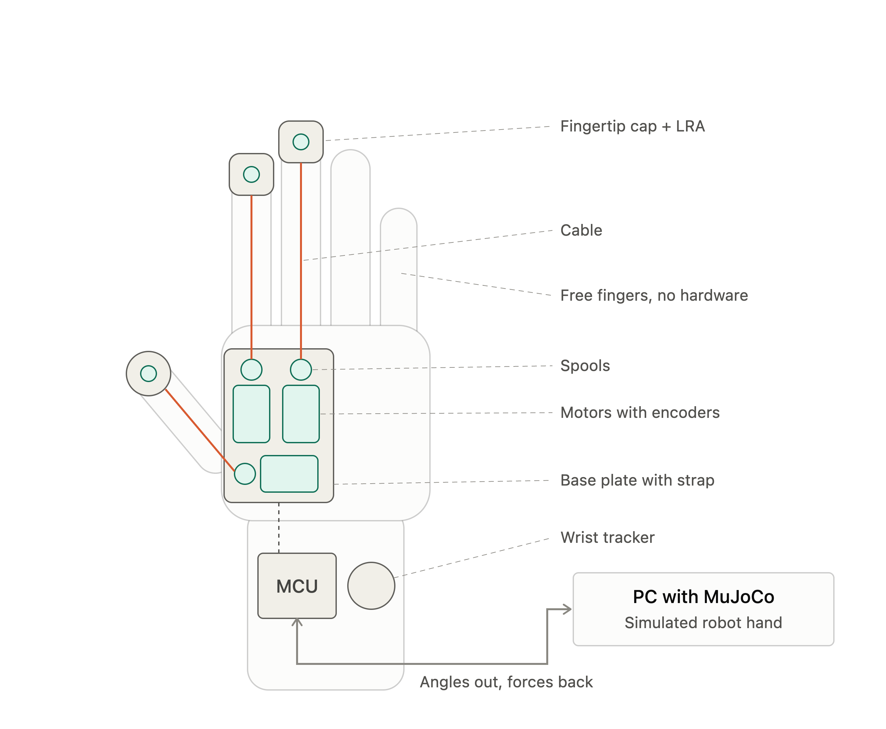

# Haptic Glove

Force-feedback glove for dexterous teleoperation. Servo-driven tendons push back on the operator's thumb, index and middle finger when the simulated hand touches an object, so grasp force can be felt instead of guessed from video. The mechanics are designed around the hand so the glove does not limit its dexterity.



> **Status: in progress.** Firmware, simulation and VR rendering run end to end with the servos on the bench; the glove mechanics are being built.

---

## How it works

| Part | Runs on | Rate | Role |
|---|---|---|---|
| `firmware/` | ESP32-S3, 3x Dynamixel XL330 | 500 Hz | Reads finger closure from the servos, applies the feedback torque in current mode, owns all safety |
| `sim/` | Python + MuJoCo | 1 kHz physics | Hand and scene simulation, contact torques per finger, wrist from a SteamVR tracker, logging |
| `rendering/HapticGlove/` | Unreal Engine | display rate | Operator view in VR, records the operator video per trial |

The glove is the clock: it sends a state frame at 500 Hz, the sim answers each one with the latest torques and echoes its timestamp, so the glove measures the round trip itself. Contact torques from the sim are not applied raw. The firmware shapes them first (contact damping, slew limit, clamping, soft start when torque is re-enabled) so a finger closed deep into an object is not snapped open.

## Safety

Every failure path ends in zero torque, handled on the glove rather than on the host:

| Event | Response |
|---|---|
| Kill switch | Torque off within one cycle, fades back in over 0.8 s on release |
| Sim stopped or link lost | Torque off within 50 ms (feedback timeout) |
| ESP reset or USB unplugged | Servos stop within 100 ms (bus watchdog) |
| Servo lost or hardware alert | Fault, all torque off, automatic re-init |

Servo temperature above 55 C fades the torque out. Without servos connected the firmware runs a stub with simulated fingers, so the full loop can be tested on a bare ESP32.

## Protocols

- [`protocol/glove_serial.md`](protocol/glove_serial.md): glove <-> sim, binary frames with CRC over USB serial (UDP for the fake glove)
- [`protocol/unreal_udp.md`](protocol/unreal_udp.md): sim <-> renderer, state at 250 Hz, scene description, commands back

## Getting started

- Firmware: build, flash, pin-out and bench tests in [`firmware/README.md`](firmware/README.md)
- Simulation: setup, input sources, calibration and logging in [`sim/README.md`](sim/README.md)
- No hardware: `python -m haptic_sim --fingers glove` with `sim/tools/fake_glove.py` runs the full protocol without a glove

## Repository layout

```
firmware/              ESP32-S3 firmware (PlatformIO, Arduino framework)
sim/                   MuJoCo simulation, tools (glove monitor, fake glove, grasp probe, log plots)
rendering/HapticGlove/ Unreal Engine project for the operator view
config/                Sim, object library and scene definitions
protocol/              Wire protocols between glove, sim and renderer
docs/                  Mechanical concept drawings, environments, references
```

## License

MIT, see [LICENSE](LICENSE).
